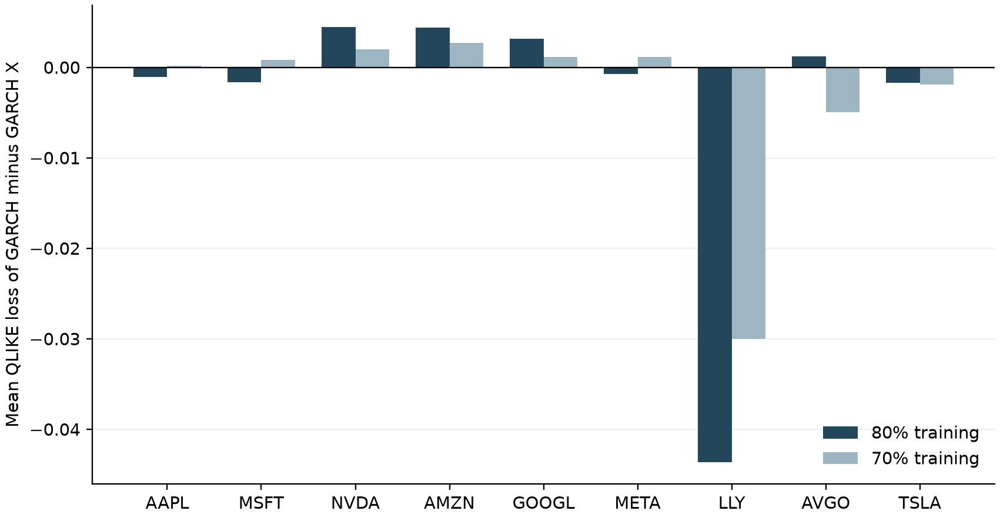

# Predicting Financial Volatility with News Sentiment Analysis

Does financial-news sentiment improve next-day volatility forecasts beyond what a GARCH model already captures?

This project scores Alpaca news headlines for ten large-cap US stocks with **FinBERT**. It aggregates the scores into a daily, exchange-calendar-aligned sentiment feature and compares out-of-sample variance forecasts from four models:

| Model | Variance equation |
|---|---|
| **GARCH(1,1)** | h<sub>t</sub> = ω + α(r<sub>t−1</sub> − μ)² + β h<sub>t−1</sub> |
| **GARCH-X** (sentiment) | h<sub>t</sub> = ω + α(r<sub>t−1</sub> − μ)² + β h<sub>t−1</sub> + γ s<sub>t</sub> |
| EWMA (RiskMetrics, λ = 0.94) | benchmark |
| Constant (training variance) | benchmark |

Here s<sub>t</sub> ∈ [−1, 1] is the mean signed FinBERT score (P(positive) − P(negative)) of the headlines published between the two market closes before the target return. The models are fit by constrained Gaussian quasi-maximum likelihood with deterministic multi-start SLSQP. The constraints ω ≥ |γ| + ε and α + β ≤ 0.999 guarantee a positive variance for any sentiment value.

📄 **Full write-up:** [output/volatility_project_report.pdf](output/volatility_project_report.pdf) (26 pages: theory, implementation, results, limitations). Editable version: [output/volatility_project_handout.md](output/volatility_project_handout.md).

## Results

Main experiment: 80/20 chronological split, one-step-ahead forecasts with parameters fixed from the training period, test period March 2025 to June 2026. The table shows mean QLIKE loss (lower is better):

| Ticker | GARCH | GARCH-X | EWMA | Constant | HAC p | Holm p |
|---|---|---|---|---|---|---|
| AAPL | **2.0751** | 2.0761 | 2.0866 | 2.2820 | 0.41 | 1.00 |
| MSFT | **2.0742** | 2.0758 | 2.0772 | 2.0941 | 0.17 | 1.00 |
| NVDA | 2.8297 | 2.8252 | **2.7731** | 2.9818 | 0.001 | 0.024 |
| AMZN | 2.4905 | **2.4861** | 2.5912 | 2.5245 | 0.34 | 1.00 |
| GOOGL | 2.3907 | 2.3875 | 2.4563 | **2.3826** | 0.24 | 1.00 |
| META | **2.7108** | 2.7116 | 2.9276 | 2.7286 | 0.94 | 1.00 |
| LLY | 3.1345 | 3.1781 | **3.0405** | 3.1943 | 0.26 | 1.00 |
| AVGO | 3.2376 | **3.2364** | 3.2581 | 3.3396 | 0.76 | 1.00 |
| TSLA | 3.3291 | 3.3307 | **3.2952** | 3.4668 | 0.20 | 1.00 |

The p-values come from an exploratory Diebold–Mariano test of GARCH vs GARCH-X with HAC standard errors.

**Takeaway: the evidence is mixed.** GARCH-X has lower average QLIKE than GARCH for 4 of 9 stocks. Only NVDA's improvement survives a Holm multiple-testing adjustment, and even there the simple EWMA benchmark beats both models. The sentiment feature tested here shows no general forecasting advantage. BRK-B is excluded because its cached news ends in October 2023.

Two robustness runs give the same picture: a 70/30 split (`sensitivity70_*`) and a run restricted to the last contiguous news segment after gaps longer than 30 days (`coverage30_*`). See [output/](output/) and Section 15 of the report.

<p align="center"></p>

## Pipeline

```
Alpaca news API ──► get_news.py ──► FinBERT (sentiusingpytorch.py / run_sentiment.py)
                                            │  headline score = P(pos) − P(neg)
yfinance prices ──► price_data.csv          ▼
        │                         per-headline sentiment
        └────────────► corrected_data.py ◄──┘
                         • XNYS session closes (+5 min), DST and early closes
                         • news bucketed into close-to-close windows, lagged one day
                         • coverage-envelope screening
                                │
                                ▼
                      corrected_forecasts.py ──► volatility_models.py
                         • fit GARCH / GARCH-X on training data
                         • sequential test filtering, EWMA and constant benchmarks
                         • QLIKE and MSE, DM-HAC tests, Holm adjustment, residual diagnostics
                                │
                                ▼
                     output/*_metrics.csv, *_forecasts.csv, *_fits.json
                                │
                                ▼
                  build_report.py ──► PDF report      verify_report.py ──► checks
```

## Repository layout

| File | Purpose |
|---|---|
| `project_config.py` | Tickers, paths, model constants, exclusions |
| `volatility_models.py` | GARCH/GARCH-X variance recursion, QMLE fitting, QLIKE, Diebold–Mariano, Holm |
| `corrected_data.py` | Price returns, exchange-calendar issuance times, sentiment aggregation |
| `corrected_forecasts.py` | Train/test experiment and all exported results (CLI) |
| `merge_data.py`, `forecast_comparision.py` | Entry points for the two pipeline steps (original filenames kept) |
| `get_news.py` | Optional: download news from Alpaca (needs API keys in `.env`) |
| `sentiusingpytorch.py`, `run_sentiment.py` | Optional: FinBERT inference and full rescoring |
| `yfinancedownload.py` | Summarise cached prices, or `--download` a fresh snapshot |
| `fitting_garch11.py`, `fitting_garch-x.py`, `insight.py` | Descriptive full-sample fits and plots |
| `audit_original.py` | Reproduces the pre-correction results from `output/original_source_before_corrections.zip` |
| `build_report.py`, `verify_report.py`, `docs/report_template.md` | Report generation and invariant checks |
| `test_project.py` | Unit tests: recursion, timing, constraints, losses, no import side effects |
| `CHANGES.md` | What was corrected relative to the original implementation, and why |

## Getting started

Python 3.13 was used.

```bash
pip install -r requirements.txt
python -m unittest test_project -v      # 8 tests, no data needed
```

### Data

The raw inputs are **not included in this repository**: news headlines (`*_news.csv`), per-headline sentiment (`*_sentiment.csv`), and prices (`price_data.csv`). Alpaca news content is not freely redistributable. To rebuild them:

```bash
pip install -r requirements-optional.txt  # also install a torch build for your CPU/GPU
cp .env.example .env                      # add your Alpaca API key and secret
python get_news.py                        # -> output/refreshed_news/
python yfinancedownload.py --download     # -> output/refreshed_prices/
python run_sentiment.py                   # -> output/rescored_sentiment/  (FinBERT)
```

Downloads go to `output/` and never overwrite the cached files. Copy them to the project root to use them as inputs. A fresh download will not be byte-identical to the original cache, whose SHA-256 hashes are recorded in `output/input_data_sha256.json`.

### Run the experiments

With the data in the project root:

```bash
python merge_data.py                                                   # build aligned features
python forecast_comparision.py                                         # main 80/20 experiment
python corrected_forecasts.py --train-fraction 0.7 --label sensitivity70
python corrected_forecasts.py --screen-long-gaps 30 --label coverage30
python audit_original.py                                               # reproduce original results
python build_report.py && python verify_report.py                      # needs reportlab + PyMuPDF
```

All forecast, metric, and fit outputs from these runs are already committed under [output/](output/), so you can inspect the results without any data.

## Limitations

- The news cache has gaps: TSLA has a 236-day gap in 2023, META starts in late 2021, and BRK-B ends in October 2023 (see `output/news_gap_audit.csv`). Article `created_at` timestamps stand in for when the news became available; they do not prove when the text was first seen.
- The 5-minute post-close issuance buffer is a convention, not measured latency.
- The positivity constraint ω ≥ |γ| is sufficient but conservative, so it narrows the feasible GARCH-X parameter set.
- The DM-HAC and Holm results are exploratory. They do not correct for the nested-model comparison.
- This is a forecasting study. It makes no causal claim and contains no trading strategy.
